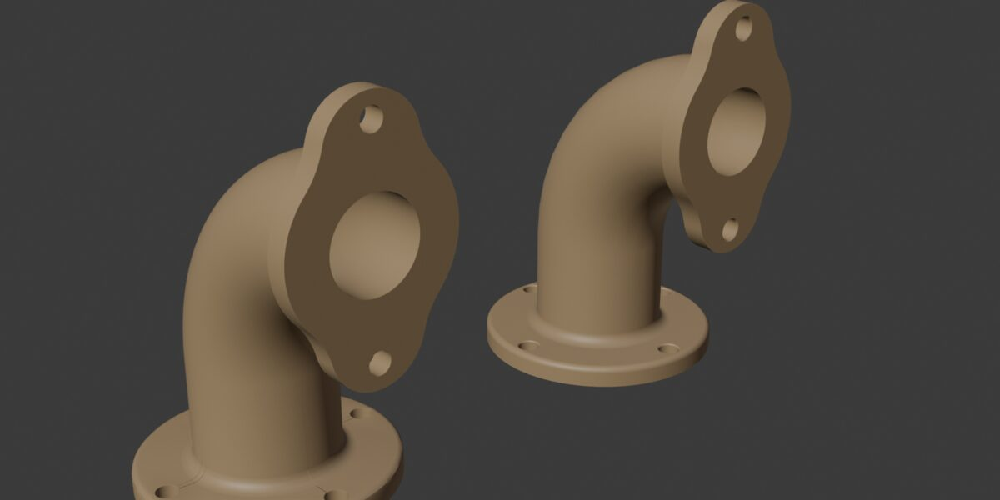
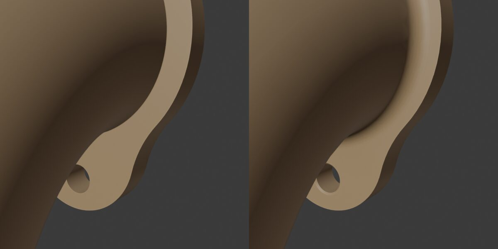

# Evaluación del kernel CAD

> Nota de continuidad (15/10/2026): la migración terminó. OpenCascade es el único
> motor CAD y OCP es obligatorio; el evaluador de malla y el selector de motor se
> retiraron. Las comparaciones y mediciones siguientes documentan estados históricos.


Fecha de la comprobación: 7 de septiembre de 2026. Alcance: primer recorrido
recomendado en las secciones 37–38 del documento solicitado, conservado en
[PLAN_CAD_PARAMETRICO_BLENDER_TABLET_REMOTE.md](../PLAN_CAD_PARAMETRICO_BLENDER_TABLET_REMOTE.md).

## Decisión para esta entrega

Usar `CadKernel` como frontera y una implementación nativa de Blender para los
perfiles simples y su extrusión. El documento paramétrico persistente es la fuente;
la malla es un resultado sustituible. No implementar un BREP, booleanos generales o
un solver universal. No anunciar operaciones que esta implementación no resuelve.

OCP es viable en el equipo comprobado: el ensayo binario descrito abajo cargó y
calculó un sólido dentro del Python de Blender. La elección nativa responde al
alcance reducido y a la distribución: el ensayo ocupó 251 MiB descomprimidos para
un único ABI/plataforma y todavía no acredita la matriz Windows/macOS/Linux ni
Blender 4.2. No significa que empaquetar OCP sea imposible. Su adaptación queda
separada del protocolo y de los documentos para un ciclo con sólidos avanzados.

## Entorno observado

- Blender instalado: 5.2.1 LTS, compilación `9e2066aef7ef`.
- Python embebido: CPython 3.13.13, arquitectura Linux x86_64.
- Python del sistema: 3.14.7; no sirve como prueba del ABI de Blender.
- En Blender: NumPy disponible; OCP, CadQuery, build123d, FreeCAD y SciPy ausentes.
- El manifest del complemento declara Blender 4.2 como mínimo. Esa versión usa
  Python 3.11 según las [notas oficiales de Blender 4.2](https://www.blender.org/download/releases/4-2/).
  Compatibilidad declarada no equivale a una ejecución comprobada en 4.2.

## Comparación

| Alternativa | Dependencias y empaquetado observado | Geometría y distribución |
| --- | --- | --- |
| CadQuery 2.8.0 / OCP | Metadatos PyPI: Python >=3.11, `cadquery-ocp>=7.9.3.1,<8.0`, VTK y dependencias numéricas. CadQuery puro ocupa poco, el kernel no. | OCCT aporta BREP, booleanos, redondeos, chaflanes y transferencia CAD. El proyecto documenta instalación pip/conda y recomienda aislamiento. |
| build123d 0.11.1 | Python >=3.10,<3.15; usa `cadquery-ocp-novtk>=7.9,<8`, NumPy 2, SciPy y otras dependencias. Evita VTK en su dependencia principal. | Otra API sobre OCCT. No elimina el requisito ABI/plataforma del kernel; no es un solver de restricciones universal listo para integrar. |
| FreeCAD Python API | El módulo no está instalado en este Blender y el nombre `FreeCAD` no tiene distribución PyPI en la consulta. FreeCAD publica una pila de dependencias nativas y paquetes por plataforma. | Host CAD completo y motor paramétrico, con mayor integración que transportar un kernel. No se probó incrustar una instalación completa de FreeCAD. |
| Blender nativo limitado | Usa las dependencias que el complemento ya tiene. | Apto para la geometría limitada del primer recorrido. No ofrece sólidos BREP ni promete fillet/STEP o topología persistente de caras. |

Fuentes primarias: [instalación de CadQuery](https://cadquery.readthedocs.io/en/latest/installation.html),
[instalación de build123d](https://build123d.readthedocs.io/en/latest/installation.html),
[metadatos CadQuery 2.8.0](https://pypi.org/pypi/cadquery/2.8.0/json),
[metadatos build123d 0.11.1](https://pypi.org/pypi/build123d/0.11.1/json),
[dependencias FreeCAD](https://freecad.github.io/Website/es/dev/setup/dependencies/),
[introducción OCCT](https://dev.opencascade.org/doc/overview/html/index.html).

CadQuery, build123d y el wrapper OCP declaran Apache 2.0. OCCT publica LGPL 2.1 con
excepción adicional; FreeCAD incluye su licencia LGPL y avisos de componentes.
La distribución futura de binarios debe incluir las licencias y avisos concretos
de los paquetes seleccionados. Referencias: [OCP](https://github.com/CadQuery/OCP/blob/master/LICENSE),
[build123d](https://github.com/gumyr/build123d/blob/dev/LICENSE),
[OCCT](https://occt3d.com/dev/doc/overview/html/occt_public_license.html),
[FreeCAD](https://github.com/FreeCAD/FreeCAD/blob/main/LICENSE).

## Ensayo reproducible

El ensayo instaló exclusivamente en un directorio temporal. No alteró el Python de
Blender, la instalación del complemento ni la escena del usuario.

```bash
blender --background --factory-startup --python-expr \
  "import sys,platform,importlib.util; print(sys.version,platform.machine()); print({n:bool(importlib.util.find_spec(n)) for n in ['OCP','cadquery','build123d','FreeCAD','scipy','numpy']})"

python3 -m pip install --target /tmp/blender-cad-kernel-spike \
  --only-binary=:all: --python-version 3.13 --implementation cp --abi cp313 \
  --platform manylinux_2_31_x86_64 --platform manylinux_2_28_x86_64 \
  --no-compile 'cadquery-ocp-novtk==7.9.3.1.1'

blender --background --factory-startup --python-exit-code 1 --python-expr \
  "import sys; sys.path.insert(0,'/tmp/blender-cad-kernel-spike'); from OCP.BRepPrimAPI import BRepPrimAPI_MakeBox; from OCP.BRepAlgoAPI import BRepAlgoAPI_Cut; from OCP.GProp import GProp_GProps; from OCP.BRepGProp import BRepGProp; a=BRepPrimAPI_MakeBox(80.,45.,20.).Shape(); b=BRepPrimAPI_MakeBox(6.,6.,20.).Shape(); cut=BRepAlgoAPI_Cut(a,b).Shape(); p=GProp_GProps(); BRepGProp.VolumeProperties_s(cut,p); print(p.Mass()); assert abs(p.Mass()-71280.)<1.e-6"
```

Resultado observado: `71280.0`, salida 0. Wheel CPython 3.13 Linux de OCP-novtk:
64,3 MiB comprimidos; instalación temporal total: 251 MiB. También se localizaron
wheels de OCP 8 para varias plataformas/ABIs, pero CadQuery 2.8 y build123d 0.11.1
requieren OCP anterior a 8: no deben mezclarse simplemente los últimos releases.

Este ensayo prueba importación y una diferencia de cajas en el host indicado.
No certifica fillets, calidad de mallado, rendimiento de documentos grandes,
la pila completa de CadQuery/build123d o su distribución multiplataforma.


## Extensión del 8 de septiembre de 2026

El workspace incorpora ahora arcos y perfiles simples de líneas/arcos, restricciones
numéricas acotadas con NumPy y vaciado por booleano exacto de Blender sobre mallas.
El redondeo de sketch recorta dos líneas y añade un arco analítico restringido.
Esta extensión conserva el kernel nativo y el documento como fuente. No integra
FreeCAD/OCP ni anuncia BREP, STEP, fillet de sólidos o Shell. La comparación binaria
anterior sigue siendo evidencia de aquella evaluación, no de una dependencia de
la entrega actual. El alcance vigente está en [cad-workspace.md](cad-workspace.md).


## Prueba OCCT con una pieza real (3 de octubre de 2026)

Pregunta: ¿resuelve OpenCascade los redondeos, chaflanes y uniones que limitan al
kernel de mallas? Se reconstruyó con OCCT el documento CAD del codo
`pieza_rara. 4.blend` (brida base, barrido de tubo, brida lateral y dos redondeos) y se
comparó con el resultado nativo. No se tocó el add-on ni la escena del usuario: el JSON
se extrajo de una copia del `.blend` y todo se ejecutó en `/tmp`.

### Entorno

- `uv venv -p 3.13` con `build123d 0.13.0`, que ya usa `cadquery-ocp-novtk 8.0.1`
  (la restricción OCP < 8 de la evaluación anterior ya no se aplica a build123d).
- Instalación: 857 MiB en total; el núcleo OCP ocupa unos 380 MiB y el resto son
  dependencias de build123d (SciPy, scikit-learn, SymPy, visores).
- Es un Python independiente de Blender. El evaluador CAD ya corre en un proceso
  auxiliar con snapshots, así que el kernel puede vivir en otro intérprete y devolver
  mallas, sin tocar el ABI del Python embebido.
- El script es [occt-spike/occt_codo.py](occt-spike/occt_codo.py). Traduce LINE/ARC/CIRCLE
  con sus marcos, regiones con huecos, EXTRUDE, SWEEP y FILLET; los FILLET guardados
  como segmentos se emparejan por geometría con las aristas BREP.

### Evaluación del documento

| Operación | OCCT | Resultado |
| --- | ---: | --- |
| Extrusión 1 (brida base) | 17 ms | válido, 8 caras |
| Redondeo 2 (2 mm, borde exterior) | 107 ms | válido; 1 arista de diseño reconocida |
| Barrido 3 (tubo Ø44/Ø28) | 34 ms | válido; cilindro + toro exactos |
| Redondeo 4 (4 mm, unión tubo-base) | 602 ms | válido; 1 arista reconocida |
| Extrusión 5 (brida lateral) | 38 ms | válido; 27 caras, 64 aristas, 41 vértices |
| **Total** | **815 ms** | volumen 147 102,7 mm³ |

El evaluador nativo tarda 2,3–2,5 s en el mismo documento sin caché (su resultado
incluye además etiquetado de superficies). STEP: 9 ms, 94 KB.

### Acabados que el documento no contenía

| Prueba | OCCT | Nativo (`finish_edges`) |
| --- | --- | --- |
| Chaflán 0,5 mm del borde inferior de la base | — | correcto |
| Redondeo 3 mm en la unión tubo-brida lateral | correcto (23 ms) | falla también a 0,3 mm |
| Chaflán 0,4 mm en los 12 bordes de taladro | correcto (16 ms) | falla también a 0,2 mm |
| Redondeo 1 mm del contorno de la brida lateral | correcto (16 ms) | no probado |
| Unión 3 mm + taladros 0,4 mm encadenados | correcto (36 ms) | — |
| Chaflán 0,5 mm en taladros (toca el redondeo de 2 mm) | rechazo explícito | — |
| Redondeo 10 mm en la unión | rechazo explícito con sugerencia `max_fillet()` | — |

Los dos rechazos de OCCT son geométricos y correctos: el taladro termina en r = 37,5 mm
y el redondeo de 2 mm empieza en r = 38 mm, de modo que 0,45 mm pasa y 0,5 mm no. El
nativo responde «El redondeo no cabe; reduce el ancho» en todos los casos de unión y
taladro, incluso con anchos diez veces menores.

### Malla para Blender

Teselado del sólido OCCT importado en Blender (fusionando 0,1 µm) frente a «Cuerpo 1»:

| Malla | Vértices | Caras | Cruzadas | Pliegues > 170° | Aristas < 0,01 mm | Caras de área nula | Aspecto > 100 | Volumen |
| --- | ---: | ---: | ---: | ---: | ---: | ---: | ---: | ---: |
| Nativa | 12 870 | 13 501 | 148 | 161 | 227 | 96 | 544 | 147 026 |
| OCCT 0,05 mm / 0,3 rad | 2 269 | 4 562 | 0 | 0 | 0 | 0 | 0 | 145 320 |
| OCCT 0,02 mm / 0,15 rad | 6 533 | 13 090 | 0 | 0 | 0 | 0 | 0 | 146 743 |
| OCCT 0,01 mm / 0,1 rad | 13 205 | 26 434 | 0 | 0 | 0 | 0 | 68 | 146 866 |
| OCCT con los acabados extra (0,02 / 0,15) | 9 519 | 19 062 | 0 | 0 | 1 | 0 | 2 | 147 041 |

Todas son cerradas. 0,02 mm / 0,15 rad iguala el número de caras del nativo sin
defectos y teseló en 27 ms. La tolerancia angular gobierna la pérdida de volumen en
los cilindros pequeños: 0,5 rad pierde un 6 %.





### Hallazgos para una migración

1. **El barrido debe producir superficies analíticas.** El `sweep` genérico de OCCT
   devolvió superficies de revolución y partió el anillo final en dos arcos y una
   B-spline; ningún redondeo de 1–4 mm cabía en él. Barrer cada línea con `extrude`
   y cada arco con `revolve` da cilindro y toro exactos, un anillo único y redondeos
   correctos. El volumen coincide (147 101 frente a 147 103 mm³).
2. **El documento arrastra ruido de captura.** El plano «Cara de Cuerpo 1» se tomó de
   la malla y está girado unos 2·10⁻⁵ rad; el arco del recorrido termina en
   (49,999; 90,001) mm. Ese micrómetro bastó para impedir el redondeo de 3 mm. Se
   resuelve de dos formas, ambas comprobadas: booleanos con tolerancia 0,001 mm
   (`fuse(tol=...)` + `clean()`), o capturar el plano de la cara BREP exacta. En
   una migración real las caras deben capturarse del BREP.
3. **Una arista de diseño puede llegar partida en varias aristas BREP.** La selección
   debe hacerse por geometría (como ya guardan los FILLET), no por índice ni por
   tipo de curva.
4. **Los fallos de OCCT son explícitos y no dejan geometría parcial**, con el mismo
   contrato de errores que el kernel actual.

### Lo que esta prueba no cubre

Rendimiento interactivo de previews (arrastre de profundidad con el lápiz), el solver
de croquis, el resto de operaciones (vaciado hasta cara, solevado, helicoidal,
revolución, simetría), la estabilidad de referencias al editar (*problema del nombre
topológico*) y la integración con el proceso auxiliar. El redondeo nativo se probó con
la función `finish_edges` y aristas elegidas por geometría, no con la interfaz.

### Conclusión

En esta pieza OCCT resuelve justo lo que limita al kernel de mallas: redondeos y
chaflanes en uniones y taladros, una malla final sin defectos y STEP. También evalúa
más rápido. Se puede ejecutar en el proceso auxiliar como Python independiente. La
siguiente comprobación útil es una preview interactiva de extrusión
sobre OCCT, para medir la latencia por paso del arrastre.

### Reproducir

```bash
mkdir -p /tmp/occt-spike && cd /tmp/occt-spike
cp "<pieza>.blend" pieza.blend
blender -b --factory-startup pieza.blend --python-expr \
  "import bpy; open('doc.json','w').write(bpy.context.scene['btr_cad_document'])"
uv venv -p 3.13 .venv && uv pip install -p .venv/bin/python build123d==0.13.0
.venv/bin/python <repo>/docs/occt-spike/occt_codo.py doc.json out 0.001
```

`out/` recibe `resultado.json`, `codo.step` y los STL de cada tolerancia.

### Integración (3 de octubre de 2026)

El add-on incorpora este motor como `cad/occt.py`, elegido en Preferencias («Motor
CAD», por defecto OpenCascade) e instalado con `blender-backend/tools/install_occt.sh`.
Aplica los tres hallazgos: barrido por tramos exactos, aristas por geometría y
booleanos difusos, que aquí se prueban primero con 1e-5 de la pieza. La suite CAD
completa pasa con ambos motores y `tests/test_cad_occt.py` usa este codo como fixture.
